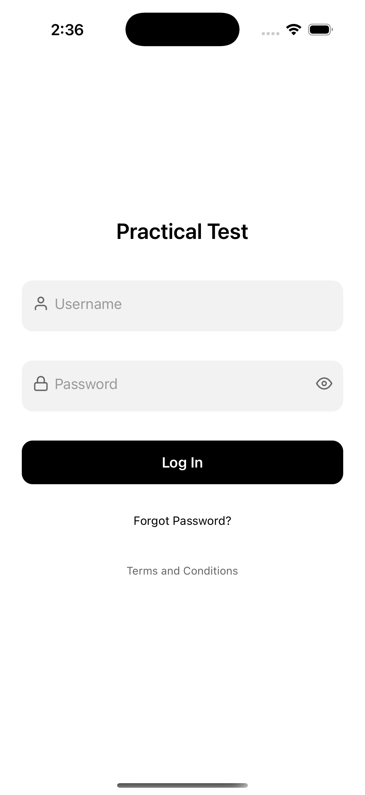
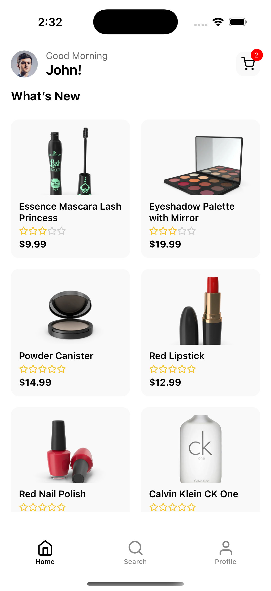
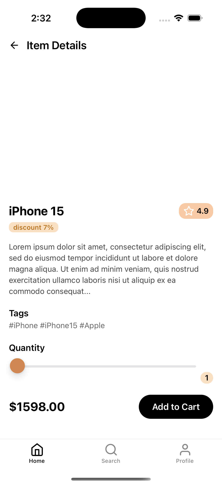
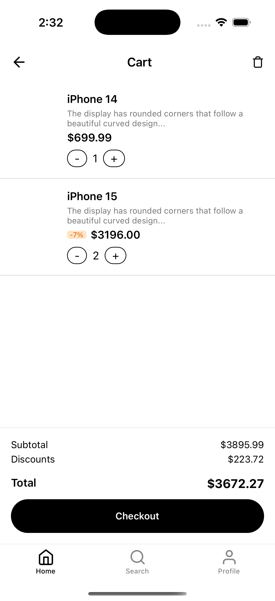
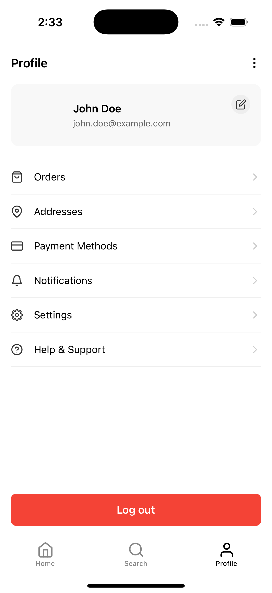
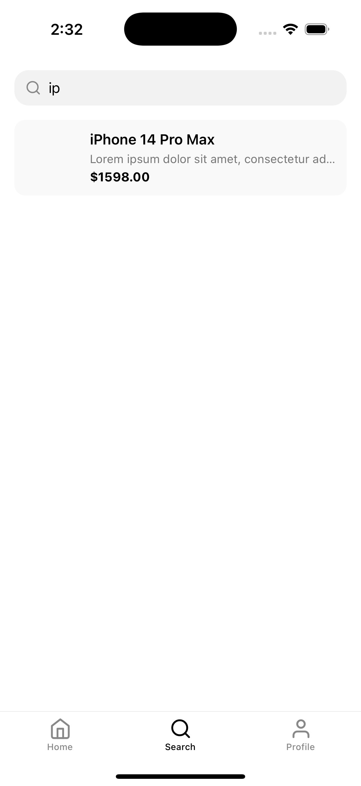
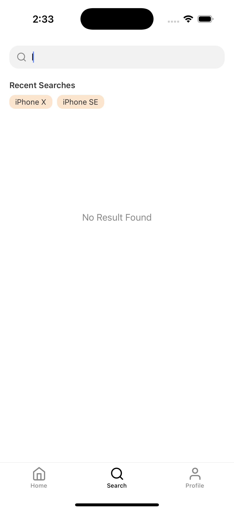

# TechCart 🛒 — React Native Practical Assessment

A simple, modern e-commerce mobile app built with **React Native 0.80.1**, demonstrating state management, side effects, navigation, form validation, and modular architecture.

This project was created as a practical assessment and uses real APIs to showcase user authentication, product listing, detail viewing, and cart handling.

---

## 🔧 Tech Stack & Features

| Feature         | Description |
|----------------|-------------|
| **React Native** | Version 0.78.2 |
| **Redux Toolkit** | Global state management |
| **Redux-Saga** | Handling async logic (API calls, session restore, etc.) |
| **React Navigation** | Stack and bottom tab navigators |
| **MMKV Encrypted Storage** | Secure token persistence |
| **Axios** | Typed HTTP client with retry support |
| **react-hook-form** | Elegant form handling and validation |
| **Reusable UI Components** | Buttons, Inputs, ProductCards, Error & Loading screens |
| **API Integration** | Uses `https://dummyjson.com` for products and auth |

---

## 📱 Screenshots

### Login Screen


### Home Screen


### Product Details


### Cart 


### Profile 


### Search 


### Recent Search 


---

## Getting Started

> **Note**: Make sure you have completed the [Set Up Your Environment](https://reactnative.dev/docs/set-up-your-environment) guide before proceeding.

### Step 1: Start Metro

```sh
# Using npm
npm start

# OR using Yarn
yarn start
```

---

## Release signing (Android)

Release builds are signed with your upload key when these properties exist in `~/.gradle/gradle.properties` (**not** in this repo):

```properties
MYAPP_UPLOAD_STORE_FILE=/absolute/path/to/upload.keystore
MYAPP_UPLOAD_STORE_PASSWORD=...
MYAPP_UPLOAD_KEY_ALIAS=...
MYAPP_UPLOAD_KEY_PASSWORD=...
```

Without them, Gradle prints a warning and falls back to the **debug** key, so `yarn android:prod:build` still works locally. Never publish such a build.

To create a keystore, follow the [React Native signing guide](https://reactnative.dev/docs/signed-apk-android). Never commit a keystore or its passwords.

Check which key signed an APK:

```sh
$ANDROID_HOME/build-tools/<version>/apksigner verify --print-certs android/app/build/outputs/apk/prod/release/app-prod-release.apk
```

---

## End-to-end tests (Detox, Android)

Detox runs against the `dev` flavor in debug and the `prod` flavor in release (see `.detoxrc.js`).

1. Create an Android emulator (AVD) in Android Studio. The config expects one named `Pixel_API_35`.
   To use a different AVD, list yours with `emulator -list-avds` and set `avdName` in `.detoxrc.js` (`devices.emulator`).
2. Start Metro: `yarn start`
3. Build and run:

```sh
yarn detox:build:android
yarn detox:test:android
```

The native test setup lives in `android/app/src/androidTest/java/com/techcart/DetoxTest.java`.
